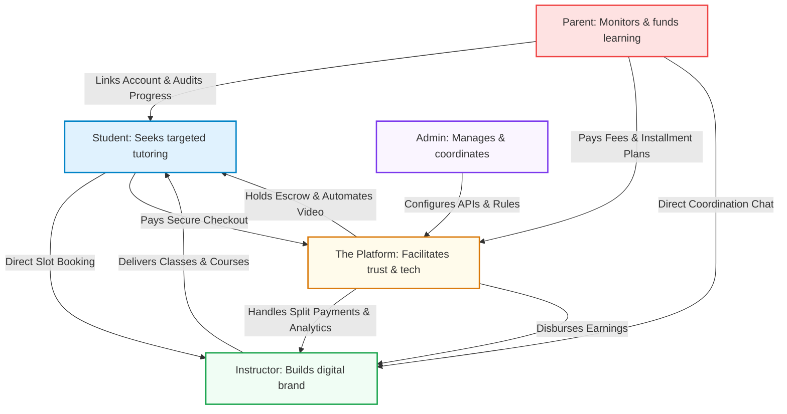
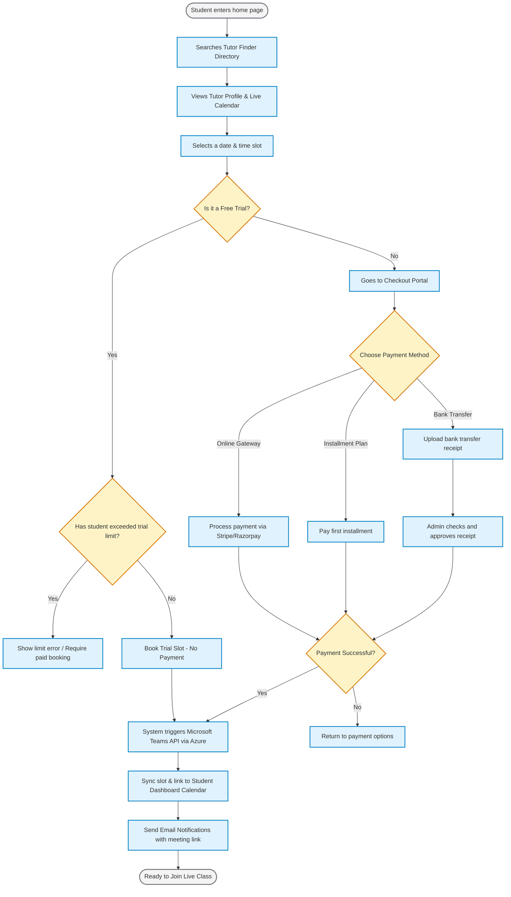
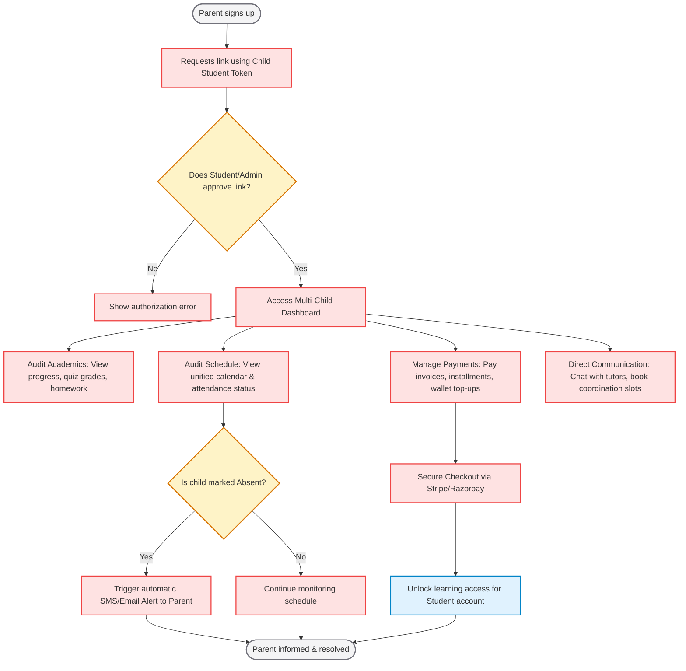
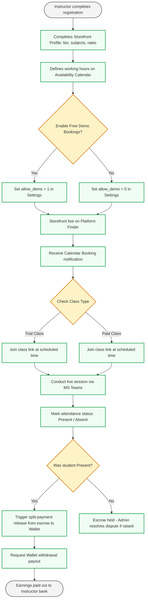
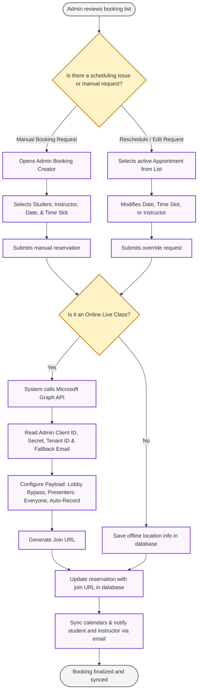

# Core Platform Features & User Experience Flow Guide

This document provides a detailed breakdown of the features, workflows, and functional capabilities of the Unified SaaS-Enabled Tutoring & Academy Platform. It is designed to give clients, stakeholders, and developers a clear, comprehensive understanding of how the four primary actors—**Students**, **Parents**, **Instructors**, and **Administrators**—interact with the platform, manage scheduling, and deliver or consume education.

---

## 1. Executive Summary: The Platform Model

The Platform represents a modern, SaaS-enabled education marketplace and academy. Unlike traditional lead-brokerage listing sites that charge instructors to access student contact details (creating friction and driving transactions offline), this platform operates on a **SaaS enablement model**. 

It empowers instructors to build independent digital storefronts while providing students and parents with direct, friction-free booking and auditing tools. The platform generates revenue through commission splits on transactions (classes, courses, digital goods) and premium membership options, ensuring a high-retention ecosystem where all parties are aligned.

---

## 2. The Student Experience (Student Flow)

The student journey is optimized to minimize friction between searching for a tutor and attending the first class. Students benefit from transparent calendar scheduling, multiple payment schemes, and a consolidated dashboard containing all their learning assets.

### 🔑 Key Student Features

#### 1. Tutor Finder & Discovery Engine
*   **Search Filters:** Students can search for instructors by subject, hourly rate, rating, languages spoken, and meeting type (online vs. offline).
*   **Availability-First View:** A search filter toggle for **"Offers Free Trials"** allows students to instantly find tutors who have open availability for a demonstration.
*   **Public Profiles:** Detailed public instructor pages containing their biography, credentials, video introduction, course catalog, reviews, and interactive calendar.

#### 2. Direct Scheduling & Booking
*   **Interactive Calendar:** Powered by an interactive scheduling calendar displaying the instructor's real-time availability. Double-bookings are dynamically blocked by database locks.
*   **Free Trial / Demo Booking:** Students can click a prominent **"Book a Free Demo"** button on the tutor profile. To prevent abuse, this is governed by global administrative limits restricting the total number of free trials a single student account can book across the platform.
*   **Direct Paid Bookings:** Students select a standard slot, select the session type (1-on-1 or group), and proceed to a secure checkout.

#### 3. Checkout & Payment Options
*   **Multiple Gateways:** Fully integrated with payment channels (e.g., Stripe, Razorpay) for instant card or wallet processing.
*   **Installment Payment Plans:** For high-cost courses or lesson bundles, students can choose to pay in predefined partial payments (installments) configured by the platform.
*   **Offline Bank Transfers:** Students can upload a photo of a bank receipt or wire transfer for administrative approval if they do not wish to pay online.
*   **Wallet System:** A built-in credit wallet allowing students to hold refunds, redeem gift cards, and make instant bookings.

#### 4. Active Calendar & Class Hub
*   **Unified Schedule:** An interactive student dashboard displaying all upcoming live classes, scheduled trials, and deadlines.
*   **Microsoft Teams Live Join:** Upcoming sessions feature a direct **"Join Class"** button. This links directly to the dynamically generated Microsoft Teams meeting.
*   **Self-Service Rescheduling:** Students can request a class reschedule directly from their calendar. This moves the session to a "Pending Instructor Approval" status to prevent unilateral changes.

#### 5. Asynchronous E-Learning Player
*   **Course Progress Tracker:** An interactive video player that remembers the student's playback position, checks off completed text lessons, and tracks chapter progress.
*   **Digital Goods Store:** Access to download associated ebooks, study guides, worksheets, and audio assets purchased directly from the instructor's store.
*   **Personal Study Notes:** A private panel inside the course player where students can save timestamps and text notes for their own revision.

#### 6. Academic Assessments & Progression
*   **Interactive Quiz Engine:** Supports multiple-choice, descriptive, matching, and fill-in-the-blank questions. Results are graded instantly (for MCQs) or queued for instructor feedback.
*   **Homework Assignments Module:** Students view homework instructions, download attachments, and upload their completed files (PDFs, images, ZIPs) for grading.
*   **Automated PDF Certificates:** Upon successfully passing a course's final assessment, the platform dynamically generates a certificate containing the student's name, completion date, instructor signature, and a validation QR code.

#### 7. Community & Support
*   **Course Forums:** A Q&A section inside each course where students can post public questions and read answers from the instructor or fellow peers.
*   **Support Ticket Center:** A portal to submit technical or financial inquiries directly to the platform administrators, complete with status updates (Open, In Progress, Resolved).

---

### 🔄 Student Journey & Booking Flow

---

## 3. The Parent Experience (Parent Flow)

The Parent Portal provides parents with dedicated oversight tools to audit their children's progress, verify class attendance, manage academic payments, and coordinate directly with tutors—without interfering in the active student learning environment.

### 🔑 Key Parent Features

#### 1. Onboarding & Secure Student Association
*   **Parent Signup Portal:** A customized sign-up and onboarding wizard designed specifically for parents or guardians.
*   **Secure Student Association:** Parents request access to their child's learning profile by entering the child's unique **Student Token** generated in the student portal. To ensure privacy, the association is established only after student or administrator approval.
*   **Multi-Child Dashboard:** Easily monitor multiple children's educational activities and accounts from a single central parent login.

#### 2. Progress Auditing & Academic Monitoring
*   **E-Learning Progress Tracker:** View real-time course syllabus coverage and check off video/chapter milestones completed by each linked student.
*   **Assessment Gradebook:** Access detailed summaries of quiz attempts (including MCQ ratios, pass status, and score trends) alongside descriptive grading feedback left by instructors.
*   **Homework Homework Tracker:** Monitor completed homework submissions, upcoming due dates, and grade breakdowns (including tutor-annotated comment sheets).

#### 3. Live Attendance & Schedule Monitoring
*   **Attendance Audit Log:** View historical attendance records for live tutoring sessions marked by instructors (`Present`, `Absent`, `Excused`).
*   **Automated Absence Alerts:** The system triggers immediate email or SMS alerts to parents if a linked student is marked `Absent` when a live virtual classroom session begins.
*   **Unified Schedule view:** A unified parent calendar showing the schedules of all linked students, complete with session statuses and scheduled times.

#### 4. Financial & Checkout Oversight
*   **Direct Bill Payments:** Pay for lesson slot bookings, course enrollments, or digital material purchases directly on behalf of linked students.
*   **Installment Management:** Monitor upcoming installment schedules, review payment histories, and complete outstanding invoice balances.
*   **Pocket Allowance Wallet:** Top up students' credit wallets to allow them to make authorized learning purchases themselves.

#### 5. Direct Parent-Tutor Coordination
*   **Direct Messaging Channel:** A secure message center to contact tutors directly to discuss a child's academic development, behavior, or extra learning requirements. This chat is distinct from the student's classroom chats.
*   **Parent-Teacher Bookings:** Request and schedule short coordination or feedback sessions directly from the tutor's calendar.

---

### 🔄 Parent Onboarding & Student Audit Flow

---

## 4. The Instructor Experience (Instructor Flow)

Instructors operate as micro-businesses within the platform. They are provided with administrative tools to control their pricing, structure their teaching content, host live classes with enterprise integrations, and manage their finances.

### 🔑 Key Instructor Features

#### 1. Storefront & Profile Management
*   **Profile Customizer:** Instructors set their bio, introduction video, list of subjects taught, teaching languages, hourly rates, and qualifications.
*   **Badges & Trust Signals:** Automatically displays system-assigned badges (e.g., "Top Rated", "Fast Responder", "Academic Expert") based on performance metrics.
*   **Student Reviews Desk:** A feedback dashboard where instructors can read and publicly reply to student reviews.

#### 2. Live Calendar & Availability Setup
*   **Time-Slot Planner:** Instructors define their weekly recurring working hours, vacation periods, and exceptions.
*   **Free Trial Toggle:** A configuration allowing instructors to enable or disable the "Book a Free Demo" button on their profile.
*   **Class Limits & Bookings:** Instructors can review pending bookings, accept or propose alternative rescheduling dates, and view student profiles prior to the session.

#### 3. E-Learning Course Creator (Asynchronous Content)
*   **Multi-Chapter Builder:** Instructors can organize courses into chapters containing video lectures, downloadable documents, and text assignments.
*   **Video Hosting Integration:** Upload videos directly or embed files from secure hosting services (e.g., Vimeo, YouTube, AWS S3).
*   **Product Store:** Upload and sell digital items (ebooks, worksheets, audio clips) or physical study kits directly to students.
*   **Pre-Launches & Waitlists:** Instructors can list "Upcoming Courses" to collect student registrations and gauge interest before officially publishing.

#### 4. Automated Virtual Classroom (Microsoft Teams Integration)
*   **API Provisioning:** The platform automates live video session creation. When a booking is finalized, the system queries the configured Microsoft Teams API.
*   **Auto-Recording Enabled:** All meetings are automatically configured to start recording (`recordAutomatically: true`) the moment the first user enters, saving files to the cloud.
*   **Guest Lobby Bypass:** Meeting rules are customized (`lobbyBypassSettings: scope: everyone`) so that students and instructors using external personal emails can enter the virtual classroom instantly without being stuck in a waiting lobby.
*   **Presenter Permissions:** Permissions (`allowedPresenters: everyone`) are set so that students can easily share their screens during interactive troubleshooting or tutoring sessions.

#### 5. Student Engagement & Grading Hub
*   **Assignments Dashboard:** View submitted student homework files, write text evaluations, and input grades.
*   **Quiz Manager:** Build quizzes, set pass marks, configure question pools, and grade descriptive answers.
*   **Noticeboard Publisher:** Send updates, announcements, or resources directly to all students enrolled in a specific course.

#### 6. Earnings Wallet & Payout Center
*   **Real-Time Balances:** Displays gross earnings, platform commission deductions, and net wallet balances.
*   **Stripe Connect / Split Escrow:** The platform holds payments in escrow until the class is marked conducted. The instructor's split is then transferred to their withdrawable wallet.
*   **Payout Request Portal:** Instructors submit payout requests (Bank Transfer, PayPal, Stripe) which are routed to the platform administrators for processing.

---

### 🔄 Instructor Operations Flow

---

## 5. The Administrator Control Center (Admin Flow)

Administrators have global visibility and governance over the system. The admin panel provides modules to oversee transactions, override scheduling, manage platform-wide integrations, and control monetization rules.

### 🔑 Key Administrator Features

#### 1. Centralized Governance & RBAC
*   **User Management:** View, search, edit, ban, or delete student, parent, and instructor accounts.
*   **Role-Based Access Control (RBAC):** Assign custom permission roles (e.g., Support Staff, Financial Auditor, Content Moderator) to restrict access to specific parts of the Admin Panel.
*   **IP Restriction Logs:** Monitor security logs and restrict specific IP ranges from accessing the administration dashboard.

#### 2. Central Booking Override Desk
*   **Manual Slot Booking:** Admins can manually create lesson bookings for any student-instructor pair, bypassing standard payment gateways (ideal for offline packages, enterprise bookings, or service recovery).
*   **Rescheduling Overrides:** Edit any existing appointment. Admins can shift the date, swap the instructor, or change the time slot, overriding standard schedule constraints.
*   **Demo Filters:** Filter the global booking list to display only "Demo Bookings" to audit trial abuse or evaluate trial-to-paid conversion rates.

#### 3. API & Integration Configuration
*   **Microsoft Teams Azure Portal Setup:** Admins configure the global OAuth connection values:
    *   **Client ID:** The Azure application identity.
    *   **Client Secret:** The secure connection token.
    *   **Tenant ID:** The organization directory.
    *   **Fallback Email:** The default Microsoft account under which meetings are scheduled.
*   **Payment Gateways Panel:** Toggle online payment processors, input API keys, and define fallback currencies.

#### 4. Financial & Monetization Controls
*   **Global Commission Configuration:** Set the default percentage commission the platform retains on course sales and calendar bookings (e.g., 10%).
*   **Subscription & Membership Packages:** Create recurring SaaS packages for instructors (e.g., Silver, Gold, Platinum) with different upload storage limits and lower transaction fees.
*   **Installment Rules Manager:** Define rules for split payment options, such as initial down-payment percentages, due date periods, and automated notification reminders.
*   **Cashback & Rewards Program:** Set up points multipliers (e.g., earn 5 reward points per $1 spent) and cashback rules for completing courses or quizzes.

#### 5. E-Commerce & Promotion Suite
*   **Marketing Banner Manager:** Publish advertising banners, floating announcement bars, and promotional popups on the front page.
*   **Discount Code Builder:** Generate global percentage coupons, fixed-amount discount codes, and flash sale timelines.
*   **Affiliate Portal:** Monitor referral links, commission payouts, and tracker histories for platform marketing campaigns.

#### 6. Content Moderation Desk
*   **Course Approval Queue:** Review submitted pre-recorded courses, chapters, and digital products to ensure they comply with content guidelines before they go public.
*   **Noticeboard & Blog Moderation:** Edit, approve, or delete comments on blogs, courses, and Q&A forums.
*   **Support Ticket Resolution:** Assign incoming support requests to staff members, write responses, and close tickets.

---

### 🔄 Admin Overrides & Meeting Provisioning Lifecycle

---

## 6. Multi-Actor Interaction Matrix

This matrix summarizes how the four actors (Students, Parents, Instructors, and Administrators) participate in key platform operations.

| Platform Phase | 👤 Student Role | 👪 Parent Role | 🟢 Instructor Role | 🟣 Administrator Role |
| :--- | :--- | :--- | :--- | :--- |
| **Account Onboarding** | Registers credentials, sets goals, and configs user profile settings. | Creates account, submits links to child student accounts, adds billing cards. | Completes teaching storefront, sets hourly rates, uploads qualification certificates. | Reviews and approves instructor applications, issues system verification badges. |
| **Tutor Discovery** | Uses search filters (price, rating, language) to select tutors. | Audits tutor biography, reads reviews, filters tutors by price to recommend. | Uploads video introduction, requests reviews from past students. | Manages featured tutor placements, monitors search rankings and filters. |
| **Class Booking** | Reserves slots on interactive calendar, updates details. | Pays for lesson slots or upcoming installments, requests rescheduling. | Manages slot availability, toggles demo settings, accepts reschedule requests. | Reviews transaction logs, processes manual bookings, overrides calendar. |
| **Virtual Class Delivery** | Joins class directly from dashboard, shares screen, uses chat. | Receives SMS/email notifications if child fails to join/attend class. | Hosts class, shares screen/whiteboard, records, and delivers tutoring. | Configures Teams connection keys, reviews server logs, audits connection errors. |
| **Attendance & Escrow** | Receives lesson status updates, submits disputes if necessary. | Monitors lesson attendance records (Present/Absent), disputes lessons if needed. | Marks attendance status (`Present`, `Absent`, `Excused`) on the calendar. | Investigates parent disputes, audits class recordings, executes escrow payouts. |
| **Course & Store E-learning** | Purchases and consumes pre-recorded video lectures and ebook files. | Purchases courses, video series, or physical books on behalf of their child. | Publishes chapters, sets video/ebook prices, manages course waiting list. | Audits video content for copyright violations, moderates digital files. |
| **Assessment & Grading** | Submits MCQ tests, descriptive quizzes, and uploads homework files. | Monitors grading progress, tracks quiz scores and descriptive feedback. | Creates quizzes/assignments, grades submitted works, uploads annotations. | Monitors platform-wide passing averages, manages dynamic certificates. |
| **Platform Economy** | Redeems discount coupons, refers friends, uses wallet balance. | Top up child's learning wallet, reviews transaction histories and receipts. | Monitors gross/net earnings wallet balance, submits payout requests. | Configures platform commission percentages, approves wallet payout requests. |
