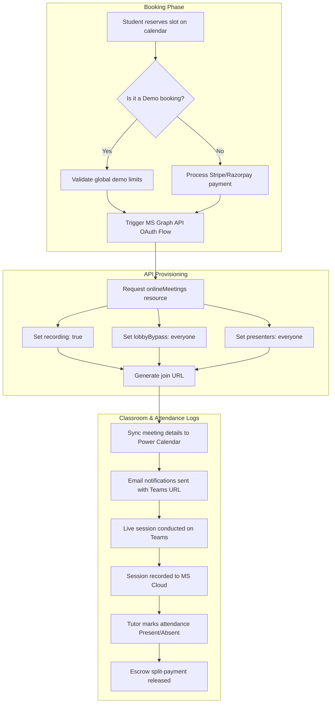

# 🏆 Master Business Analyst Report & Market Conquest Strategy
## Scholarb LMS vs. UrbanPro
**Prepared by:** Lead EdTech Product Strategist & Senior Business Analyst
**Scope:** Scholarb LMS Features vs. UrbanPro (ERPGo CRM excluded/focused on LMS-specific features)

---

## 1. Executive Summary

This report delivers a strategic comparison between **UrbanPro** and **Scholarb LMS**. It details the business dynamics, user lifecycle, and technical features of both platforms. By identifying the core friction points of UrbanPro, we outline how Scholarb can capture market share, increase tutor retention (reducing supplier churn), and offer a superior user experience.

---

## 2. Model & Market Positioning: Lead Aggregator vs. SaaS Enablement

| Dimension | 🇮🇳 UrbanPro | 🚀 Scholarb LMS |
| :--- | :--- | :--- |
| **Business Model** | **Lead-Brokerage Marketplace** Monetizes the connection step by selling user contacts. | **SaaS-Enabled Academy & Marketplace** Monetizes value-added tools, transactions, or subscriptions. |
| **Supplier Relationship** | **Commoditized Supplier Listing** Tutors are directory records; branding is restricted. | **Independent Storefronts** Tutors build their own brand, courses, and schedules. |
| **Marketplace Friction** | **High Leakage** Tutors actively bypass the system once contact is made. | **High Retention** Tutors stay to use the calendar, courses, and tools. |

### 🔄 Student Acquisition & Booking Flow Diagram

```mermaid
graph TD
    subgraph UrbanPro Flow [UrbanPro: Lead-Bidding Flow]
        U1[Student posts general enquiry] --> U2(Verification Callback/OTP)
        U2 --> U3[Lead broadcasted to multiple tutors]
        U3 --> U4{Tutor spends coins?}
        U4 -- No --> U5[No connection made]
        U4 -- Yes --> U6[Unlock contact number]
        U6 --> U7[Tutor calls student manually]
        U7 --> U8[Student spammed by 10 calls]
    end

    subgraph Scholarb Flow [Scholarb: Direct Calendar Booking]
        S1[Student searches directory] --> S2[Views Tutor profile & Live Calendar]
        S2 --> S3{Selects slot & Books class}
        S3 -- Free Demo --> S4[Demo limits validated]
        S3 -- Paid Class --> S5[Secure Checkout payment]
        S4 --> S6[Auto-creates MS Teams session]
        S5 --> S6
        S6 --> S7[Both calendars updated instantly]
    end
```

---

## 3. Feature-by-Feature Deep Comparison

### Category A: Lead Acquisition & Discovery

#### 1. Student Request Capture (Enquiry Ingestion)
*   **UrbanPro:**
    *   *Mechanism:* Multi-step wizard matching categories, school boards, budgets, timings, and pincodes.
    *   *Business Impact:* Captures high-volume search intent but leads to high tutor competition. Broadcasts a single lead to up to 10 tutors, spamming the student and frustrating 90% of bidding tutors.
*   **Scholarb LMS:**
    *   *Mechanism:* Public Tutor Finder with direct-to-profile search and real-time scheduling visibility.
    *   *Business Impact:* Promotes targeted, high-intent matching. Students select a specific tutor based on calendar availability, reducing drop-offs and spam.

#### 2. Discovery Filters
*   **UrbanPro:**
    *   *Mechanism:* Filters by subject, location (home tuitions), and budget. Results are weighted heavily toward tutors paying premium subscriptions.
*   **Scholarb LMS:**
    *   *Mechanism:* Filters by rating, price, language, meeting type (online/offline), and **"Offers Demo Booking"** toggle. Results are weighted by merit (ratings, availability).

---

### Category B: Scheduling & Booking Engine

#### 1. Real-Time Slot Reservations
*   **UrbanPro:**
    *   *Mechanism:* None. Scheduling is coordinated manually via phone or chat after the lead contact is bought.
    *   *Business Impact:* High coordinator friction and double-booking risks.
*   **Scholarb LMS:**
    *   *Mechanism:* **Power Calendar (FullCalendar.js).** Live interactive calendars displaying open slots directly on tutor profiles.
    *   *Business Impact:* Instant conversion. Students book classes in two clicks, and slots are locked automatically in the database.

#### 2. Rescheduling & Attendance Workflows
*   **UrbanPro:**
    *   *Mechanism:* Manual chat agreement.
    *   *Business Impact:* Prone to financial disputes and administrative overhead.
*   **Scholarb LMS:**
    *   *Mechanism:* Interactive calendar dashboard supporting drag-and-drop rescheduling (with request/approval flow) and attendance statuses (`Present`, `Absent`, `Excused`).
    *   *Business Impact:* Eliminates scheduling disputes. Tracks teaching hours automatically with complete audit logs.

#### 3. Free Demo Bookings
*   **UrbanPro:**
    *   *Mechanism:* Tutors must spend coins to accept free demo requests from students.
    *   *Business Impact:* Tutors lose capital on trials that do not convert, driving up tutor acquisition costs.
*   **Scholarb LMS:**
    *   *Mechanism:* Prominent **"Book a Free Demo"** button on profile sidebars. Governed by global limits per student to prevent abuse.
    *   *Business Impact:* Lowers the conversion barrier for students at zero cost to the tutor.

---

### Category C: Classroom Tech & Live Delivery

#### 1. Live Video Classroom
*   **UrbanPro:**
    *   *Mechanism:* "UrbanPro LIVE" (proprietary WebRTC streaming and whiteboard).
    *   *Business Impact:* High development and hosting overhead; vulnerable to poor performance on slow internet connections.
*   **Scholarb LMS:**
    *   *Mechanism:* Native API integration with **Microsoft Teams** (and support for Zoom, BBB, Jitsi, Google Meet).
    *   *Business Impact:* Enterprise-grade reliability. Handled via the Azure Graph API with automated recording enabled (`recordAutomatically: true`), everyone-lobby-bypass, and screen-sharing permissions set to everyone.

#### 2. Recording & Revisions
*   **UrbanPro:**
    *   *Mechanism:* Stored and viewed inside the UrbanPro dashboard.
*   **Scholarb LMS:**
    *   *Mechanism:* Recorded MS Teams sessions automatically link back to the student's personal calendar dashboard.
    *   *Business Impact:* Zero storage maintenance costs for the platform owner while keeping student revision logs structured.

### 📅 Meeting Lifecycle & Classroom Automation Flow

---

### Category D: Asynchronous E-Learning & Assessment

#### 1. Recorded Courses & Digital Store
*   **UrbanPro:**
    *   *Mechanism:* None. Limited exclusively to live tutoring hours.
*   **Scholarb LMS:**
    *   *Mechanism:* Complete course player (video, text, chapters) and digital/physical product store (notes, ebooks, revision kits).
    *   *Business Impact:* Allows tutors to productize their knowledge. Tutors generate passive income, and the platform monetizes digital sales, increasing overall LTV.

#### 2. Assessments & Assignments
*   **UrbanPro:**
    *   *Mechanism:* Basic MCQ mock test builder.
*   **Scholarb LMS:**
    *   *Mechanism:* Advanced Quiz Builder (MCQs, Descriptive, matching, pools) + homework **Assignments Module** with file upload and grading dashboard.
    *   *Business Impact:* High academic engagement. Parents and students track grading, homework completion, and learning milestones.

#### 3. Automated Certificates
*   **UrbanPro:**
    *   *Mechanism:* None.
*   **Scholarb LMS:**
    *   *Mechanism:* Automatically generated PDF completion certificates with custom signatures and verification QR codes.
    *   *Business Impact:* Student motivation + organic social media marketing when certificates are shared on LinkedIn.

---

## 4. The Coin System vs. Scholarb Commission Model

### Tutor Unit Economics Comparison (Monthly Estimate)

| Metric | 🇮🇳 UrbanPro (Coin Model) | 🚀 Scholarb LMS (Commission Model) |
| :--- | :--- | :--- |
| **Upfront Cost** | **$50 - $100** (Premium Plans + Coins) | **$0** (Free to register and set up) |
| **Enquiry Leads Bought** | 20 leads | N/A (Direct organic calendar bookings) |
| **Conversion Rate** | 10% (2 students acquired) | 30% of trials (2 students acquired) |
| **Gross Monthly Revenue** | $100 (2 students @ $50) | $100 (2 students @ $50) |
| **Platform Commission** | $0 (Tutor keeps fee) | 10% Platform Commission ($10) |
| **Tutor Net Profit** | **$0 to $50** (High risk of loss) | **$90** (Zero risk of loss) |
| **Tutor Loyalty / Churn** | **High Churn** (Leads don't convert $\rightarrow$ Tutors quit) | **Low Churn** (Pay-only-when-you-earn) |

---

## 5. Strategic Development Roadmap for Scholarb LMS

To out-compete UrbanPro, we should prioritize the following enhancements:

### Phase 1: Custom subdomains for Tutors
*   **Objective:** Give tutors a professional brand identity (Shopify-for-Tutors play).
*   **Task:** Route requests like `username.scholarb.org` to the tutor’s public profile page in Laravel routes.

### Phase 2: Gateway Escrow & Split Payments
*   **Objective:** Safe payments that lock in trust.
*   **Task:** Integrate Stripe Connect Split Payments. Hold 90% of the class fee in escrow. Automatically release it to the tutor's wallet 24 hours after the class status in the Power Calendar is marked as `Present` by the instructor.

### Phase 3: AI-Powered Search Discovery
*   **Objective:** Frictionless slot search.
*   **Task:** Deploy an AI search widget where students query slots in natural language (e.g., "Math tutor free on Sunday morning under $20") and receive direct links to book.
