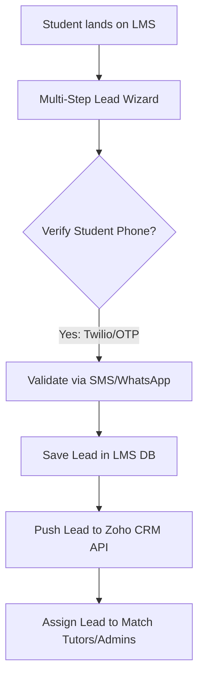
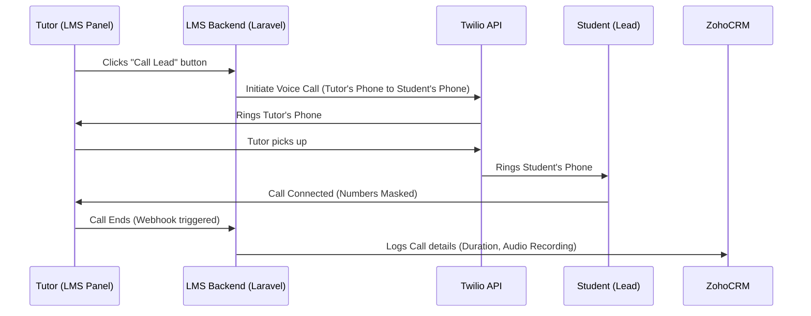

# 🏆 Zoho CRM & High-Performance Lead Capture Integration Guide

This guide details the steps to integrate **Zoho CRM**, set up **Click-to-Call Telephony**, and construct a **High-Converting Lead Capture and Verification System** inside the Scholarb LMS.

---

## 🔐 Part 1: Zoho CRM API Integration & Credentials

To establish a secure, automated connection between the LMS and Zoho CRM, we use Zoho's standard OAuth 2.0 protocol.

### 1. Credentials Needed
To configure the integration, you must obtain the following from the [Zoho Developer Console](https://api-console.zoho.com/):
1. **Client ID**: Unique identifier for the LMS application.
2. **Client Secret**: Private key used to authenticate client requests.
3. **Authorized Redirect URI**: The URL Zoho redirects to after admin authorization.
   - Example: `https://scholarb.org/admin/settings/zoho/callback`
4. **Zoho Data Center Region (TLD)**: Zoho accounts are region-locked. The API base URL and token URL depend on the region:
   - **US**: `https://accounts.zoho.com` / `https://www.zohoapis.com`
   - **EU**: `https://accounts.zoho.eu` / `https://www.zohoapis.eu`
   - **IN**: `https://accounts.zoho.in` / `https://www.zohoapis.in`
   - **AU**: `https://accounts.zoho.com.au` / `https://www.zohoapis.com.au`

### 2. Step-by-Step Zoho Developer Console Setup
1. Go to the [Zoho API Console](https://api-console.zoho.com/).
2. Click **Add Client** and select **Server-based Applications**.
3. Fill in the following details:
   - **Client Name**: `Scholarb LMS`
   - **Homepage URL**: `https://scholarb.org`
   - **Authorized Redirect URIs**: `https://scholarb.org/admin/settings/zoho/callback`
4. Click **Create**. Copy the **Client ID** and **Client Secret**.

### 3. API Scopes Required
During the authorization redirect, request the following scopes to allow reading/writing data:
- `ZohoCRM.modules.leads.CREATE`, `ZohoCRM.modules.leads.UPDATE`, `ZohoCRM.modules.leads.READ` (Manage general leads)
- `ZohoCRM.modules.contacts.CREATE`, `ZohoCRM.modules.contacts.UPDATE`, `ZohoCRM.modules.contacts.READ` (Manage students/tutors)
- `ZohoCRM.modules.deals.CREATE`, `ZohoCRM.modules.deals.UPDATE` (Record course payments/enrollments)
- `ZohoCRM.modules.calls.CREATE`, `ZohoCRM.modules.calls.UPDATE` (Log call records/telephony logs)
- `ZohoCRM.modules.ALL` (Optional, broad scope)
- `offline_access` (**Mandatory**: returns a `refresh_token` so the server can generate new access tokens without requiring user login every hour).

---

## 🎯 Part 2: High-Performance Lead Capture & Verification (UrbanPro Model)

To capture leads effectively and prevent spam (fake phone numbers/emails), the system should feature a multi-step requirement wizard and phone verification.



### 1. The Multi-Step Lead Capture Wizard
Unlike a basic contact form, a high-converting system asks structured questions to identify high-intent leads:
- **Class Level/Goal**: (e.g., Grade 10, IIT-JEE Prep, Conversational English)
- **Subject**: (e.g., Physics, Calculus)
- **Curriculum/Board**: (e.g., CBSE, ICSE, IB, Cambridge)
- **Budget**: per hour or monthly budget.
- **Preferred Timings**: (e.g., Weekends, Evening, Morning)
- **Location Type**: (Online, Student's Home, Tutor's Center)

### 2. Phone Verification (OTP) to Eliminate Churn
UrbanPro uses an immediate callback or OTP verification. In the LMS, we implement this as follows:
- We use **Twilio** or **MSG91** (both already supported in `composer.json` dependencies).
- When the student enters their mobile number, an OTP is dispatched.
- The lead remains in a "Pending Verification" state and is **only** sent to Zoho CRM once verified. This guarantees CRM clean data and high lead quality.

### 3. Lead Flow & Routing Models
Once a lead is verified, it enters Zoho CRM:
- **LMS Sync**: The lead is saved in the LMS database (under a `leads` table).
- **CRM Sync**: The `ZohoCrmService` calls `POST /crm/v2/Leads` with fields mapped:
  ```json
  {
    "data": [
      {
        "First_Name": "Jane",
        "Last_Name": "Doe",
        "Email": "jane.doe@example.com",
        "Phone": "+919876543210",
        "Lead_Source": "LMS Inquiry Wizard",
        "Subject_Interest": "Calculus",
        "Budget_Range": "500-1000/hr",
        "Lead_Status": "New"
      }
    ]
  }
  ```
- **Tutor Matching & Bidding (UrbanPro Model)**:
  - Inside the LMS, matching tutors (based on subject, curriculum, budget) are notified.
  - Tutors can unlock the lead's contact details by spending "Coins/Points" (LMS credit system).
  - Tutors can click the phone number directly on the LMS dashboard to call the lead.

---

## 📞 Part 3: Click-to-Call Telephony & Call Logging

There are two primary ways to handle calls to leads so they are logged in Zoho CRM: **Option A (Zoho PhoneBridge)** and **Option B (Direct LMS-Twilio click-to-call)**.

### Option A: Zoho PhoneBridge (Inside Zoho CRM)
If your admin or sales team handles calls directly from the Zoho CRM dashboard:
1. **How it works**: Zoho CRM integrates with telephony systems (like Twilio, RingCentral, Exotel, Tata Telephony) via **Zoho PhoneBridge**.
2. **Setup**:
   - Go to Zoho CRM -> **Setup** -> **Channels** -> **Telephony**.
   - Choose your provider (e.g., Twilio).
   - Enter your account credentials (e.g., Twilio Account SID and Auth Token).
   - Assign phone numbers to CRM users.
3. **Usage**:
   - A green phone icon appears next to phone numbers in Zoho CRM.
   - Clicking the icon dials the lead directly from the browser/computer.
   - When a call ends, a pop-up asks to record the call notes, status, and duration, which are saved in the **Calls** module.

---

### Option B: Direct LMS Click-to-Call (Tutor Panel)
If your tutors or administrators use the LMS panel to call students:
We implement a **Number Masking & Click-to-Call** solution using Twilio. This protects student privacy (tutors don't see the actual phone number) and logs the outcome.



#### Step-by-Step Implementation of LMS Click-to-Call:
1. **Tutor clicks "Call"** on the Lead details page.
2. **LMS Backend makes an API call to Twilio REST client**:
   - Twilio triggers a voice call to the Tutor's phone number first.
   - Once the tutor answers, Twilio dials the Lead's phone number.
3. **Call logs callback**:
   - Twilio sends a webhook (e.g., `POST /api/webhooks/twilio-call-ended`) when the call completes.
   - The webhook returns call metadata (duration, success status, recording URL).
4. **Sync Call Log to Zoho CRM**:
   - The LMS hooks into the webhook and calls Zoho CRM API to log the call:
     `POST https://www.zohoapis.com/crm/v2/Calls`
     ```json
     {
       "data": [
         {
           "Subject": "Tutor Inquiry Call",
           "Call_Type": "Outbound",
           "Call_Duration": "02:15",
           "Call_Start_Time": "2026-07-28T17:40:00+05:30",
           "What_Id": {
             "id": "zoho_lead_id_here",
             "name": "Leads"
           },
           "Description": "Tutor discussed requirements. Student interested in enrolling.",
           "Call_Result": "Completed / Interested"
         }
       ]
     }
     ```

---

## 🛠️ Part 4: Step-by-Step Database & Code Integrations

Here is how our development workflow will integrate these modules into the LMS:

### Step 1: Settings Migration & Database Update
Run a database migration to create the default settings rows for `zoho_crm`:
```php
Schema::table('users', function (Blueprint $table) {
    $table->string('zoho_lead_id')->nullable()->index();
    $table->string('zoho_contact_id')->nullable()->index();
});
```

### Step 2: Build the ZohoCrmService Client
This class will reside under `lms/app/Services/ZohoCrmService.php` to handle OAuth token refreshing automatically:
```php
public function getAccessToken()
{
    $settings = getFeaturesSettings('zoho_crm'); // Fetch config
    if (time() < $settings['expires_at']) {
        return $settings['access_token'];
    }
    
    // Perform token refresh request
    $response = Http::post("https://accounts.zoho.com/oauth/v2/token", [
        'refresh_token' => $settings['refresh_token'],
        'client_id' => $settings['client_id'],
        'client_secret' => $settings['client_secret'],
        'grant_type' => 'refresh_token',
    ]);
    
    // Save updated access token and new expiry time (current time + 3600s)
    ...
}
```

### Step 3: Set up Webhook & Event Listeners
We link into standard hooks:
- **Registration Hook**: Add user details to Zoho Leads.
- **Purchase Hook**: Create Deal and link it to the Contact.
- **Twilio Callback Webhook**: Logs telephony status and records call details automatically.
